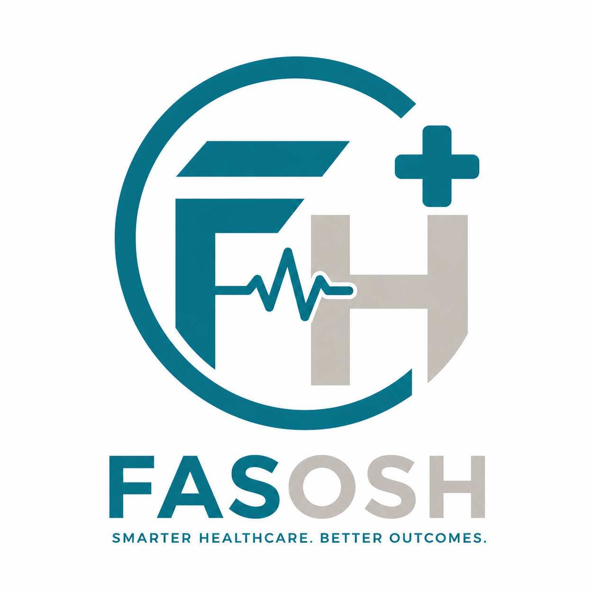

  

**FASOSH**

  <a href="https://health.fasosh.com">Product Website</a> ·
  <a href="https://fasredtech.com">FASRED Technologies</a>

FASOSH is a healthcare operating platform by **FASRED Technologies Ltd**, designed to connect patients, healthcare professionals, facilities, clinical services, resources, and operational workflows within one configurable system.

Healthcare does not happen in isolated departments. A patient's journey may involve registration, triage, consultation, laboratory investigations, imaging, pharmacy, billing, admission, referral, and follow-up. Each stage depends on people, information, decisions, and resources across the organisation.

FASOSH is being developed to connect these activities so healthcare organisations can coordinate care and operations around a shared understanding of what has happened, what is happening now, and what should happen next.

## Our Vision

To provide a connected digital operating foundation for healthcare organisations of every size, supporting the complete healthcare lifecycle while allowing each organisation to operate according to its own structure, services, and needs.

## One Connected Healthcare System

FASOSH is not limited to appointment scheduling, electronic medical records, billing, or hospital administration in isolation.

Its vision is to bring healthcare operations together through shared patient and operational context.

A patient's journey may follow this path:

1. **Arrival and registration** — Identify the patient, establish the visit, and determine the required service.
2. **Assessment and triage** — Support appropriate assessment, prioritisation, and routing by authorised healthcare professionals.
3. **Consultation and care planning** — Coordinate clinical documentation, decisions, orders, and care activities.
4. **Diagnostics and investigations** — Connect requests, laboratory and imaging workflows, results, and clinical review.
5. **Treatment and medication** — Coordinate treatment activities, prescriptions, pharmacy workflows, and relevant clinical records.
6. **Billing and coverage** — Support applicable payment, billing, and health insurance workflows.
7. **Admission and ongoing care** — Coordinate applicable wards, beds, inpatient services, and transfers.
8. **Discharge, referral, and follow-up** — Support continuity of care, onward referrals, discharge documentation, and planned follow-up.
9. **Review and improvement** — Use appropriate records, reports, and operational information to support accountability and service improvement.

Not every patient requires every stage. FASOSH is intended to support the relevant pathway for each care setting.

## Designed for Different Healthcare Organisations

The same product vision extends across healthcare settings without requiring every organisation to operate like a large hospital.

FASOSH is intended to support:

- Pharmacies and diagnostic laboratories
- Primary healthcare centres and general practices
- Specialist, eye, dental, and other clinics
- Maternity, rehabilitation, and urgent-care services
- General and teaching hospitals
- Multi-campus and multi-location healthcare organisations
- Healthcare networks and public healthcare programmes
- Regional, national, and larger healthcare organisations

Organisations should be able to configure the facilities, departments, services, workflows, permissions, and capabilities relevant to their operations.

## What FASOSH Is Designed to Connect

### Patient and Clinical Care

Patient registration, appointments, walk-ins, encounters, clinical documentation, care coordination, referrals, discharge, and follow-up.

### Patient Flow and Emergency Coordination

Queues, service routing, workload visibility, resource availability, handovers, and operational coordination, including workflows for emergency and time-critical care.

### Diagnostic and Treatment Services

Applicable laboratory, imaging, pharmacy, inpatient, theatre, intensive care, and other clinical service workflows.

### Healthcare Administration

Billing, payments, health insurance and HMO workflows, patient communication, reporting, and administrative coordination.

### Facilities, Resources, and Equipment

Visibility into relevant rooms, beds, service points, equipment, and resource availability. Where appropriate, FASOSH is intended to connect with FASWORK for enterprise asset and maintenance operations rather than duplicate its responsibilities.

### Governance and Organisational Oversight

Appropriate access controls, traceable activities, operational reporting, privacy safeguards, and oversight across authorised organisational levels.

### Interoperability

A foundation for connecting appropriate external clinical, diagnostic, financial, identity, communication, and operational systems as supported integrations become available.

These are areas of intended product scope. Individual capabilities and integrations must be verified against the actual implementation before being represented as available.

## From Individual Facilities to Connected Healthcare Networks

FASOSH is intended to support organisations with configurable structures such as:

**Organisation → Region → Facility → Department → Unit → Service → Service Point**

The applicable levels depend on the organisation. A small clinic should not need to manage the same organisational complexity as a teaching hospital or national healthcare network.

Where multiple facilities operate under one organisation, each facility should be able to manage its authorised local operations while participating in appropriate organisation-wide coordination and reporting.

Independent organisations must remain appropriately separated, with access governed by authorised relationships and permissions.

## Safety, Privacy, and Accountability

Healthcare software must be designed with the consequences of its decisions and failures in mind.

FASOSH's guiding principles include:

- **Clinical accountability:** Qualified healthcare professionals retain responsibility for clinical judgement and decisions.
- **Patient safety:** Critical workflows, handovers, and relevant operational risks require appropriate safeguards and verification.
- **Privacy and access control:** Healthcare information must be protected through appropriate permissions and security measures.
- **Traceability:** Important actions and decisions should be appropriately recorded and reviewable.
- **Reliability and recovery:** Workflows must account for interruptions, failures, and recovery rather than assume uninterrupted system availability.
- **Responsible automation:** Automated notifications and operational assistance must not be treated as guarantees that a patient has been assessed or treated.
- **Continuous improvement:** Product decisions should be guided by evidence, validated requirements, and measurable outcomes.

These principles guide development; they do not, by themselves, constitute proof of clinical validation, regulatory compliance, or production readiness.

## Development Direction

FASOSH is being developed incrementally toward its broader healthcare operating platform vision.

Development priorities include:

1. Establishing a reliable foundation for organisations, facilities, users, permissions, and core healthcare workflows.
2. Connecting patient journeys, clinical activities, service queues, and operational coordination.
3. Advancing emergency coordination and monitoring with appropriate safety safeguards.
4. Connecting applicable diagnostic, treatment, inpatient, referral, financial, and administrative services.
5. Extending coordinated operations across multiple facilities and organisational levels.
6. Developing appropriate analytics, interoperability, and decision-support capabilities as requirements and validation permit.

The sequence and availability of individual capabilities depend on implementation progress, customer requirements, testing, and applicable clinical and operational validation.

## Product Status

FASOSH is under active development. The complete product vision extends beyond any single module or release.

This public repository documents the product's purpose, intended capabilities, principles, and development direction. The application codebase and detailed internal implementation specifications are maintained separately.

A capability should be described as implemented, available, or production-ready only when that status is supported by appropriate evidence.

## About FASRED Technologies

FASOSH is developed by **FASRED Technologies Ltd**.

**Technology Engineered for Impact.**

- **FASOSH product website:** https://health.fasosh.com
- **Company website:** https://fasredtech.com

For product enquiries, prospective deployments, partnerships, and collaboration, visit the FASRED Technologies website.

## Ownership and Intellectual Property

FASOSH is a product of FASRED Technologies Ltd. This repository provides public product information and documentation. Access to this repository does not grant access to the private application codebase or permission to reproduce the product or use its branding.
